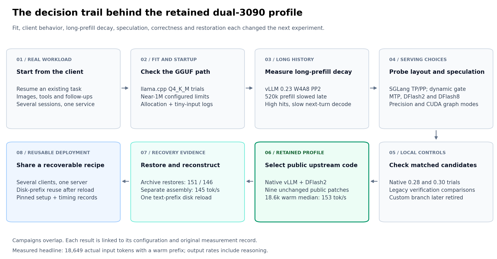
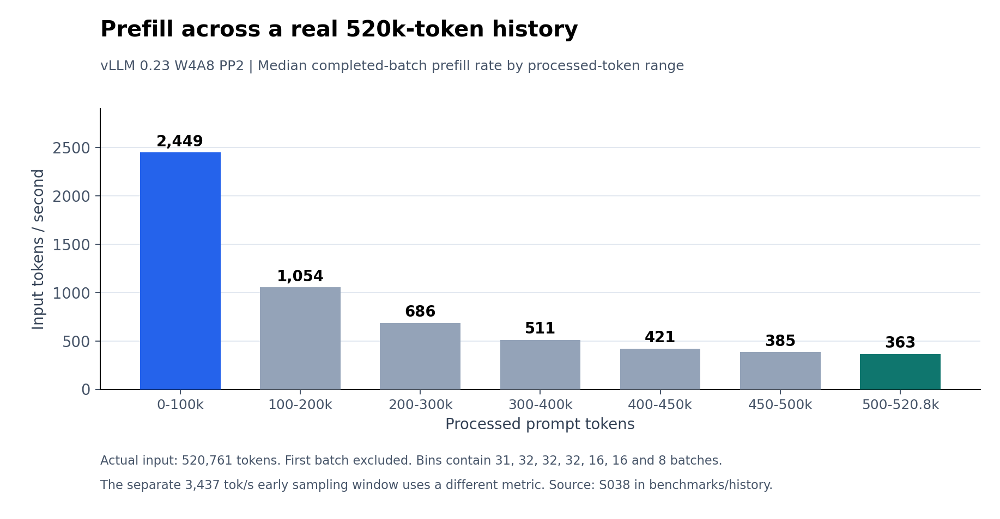
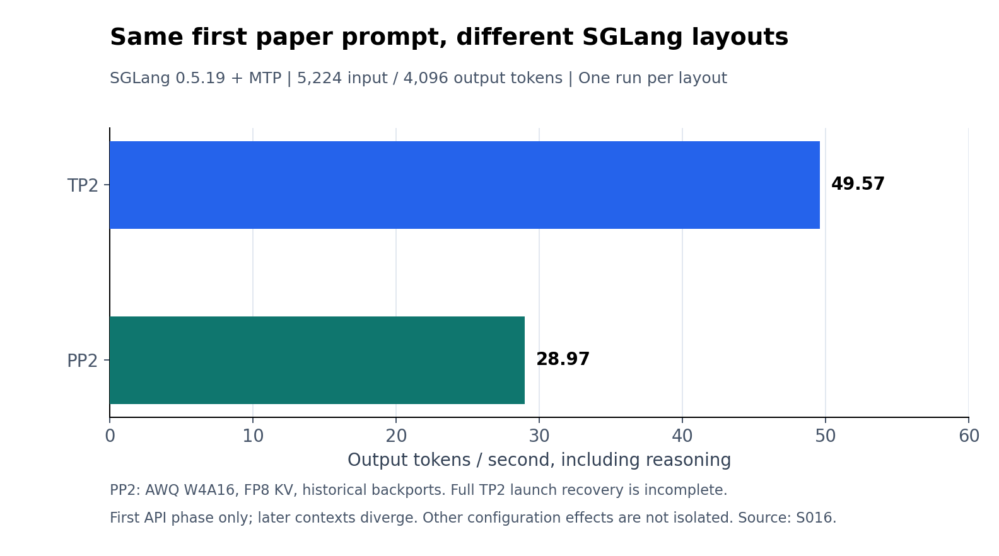
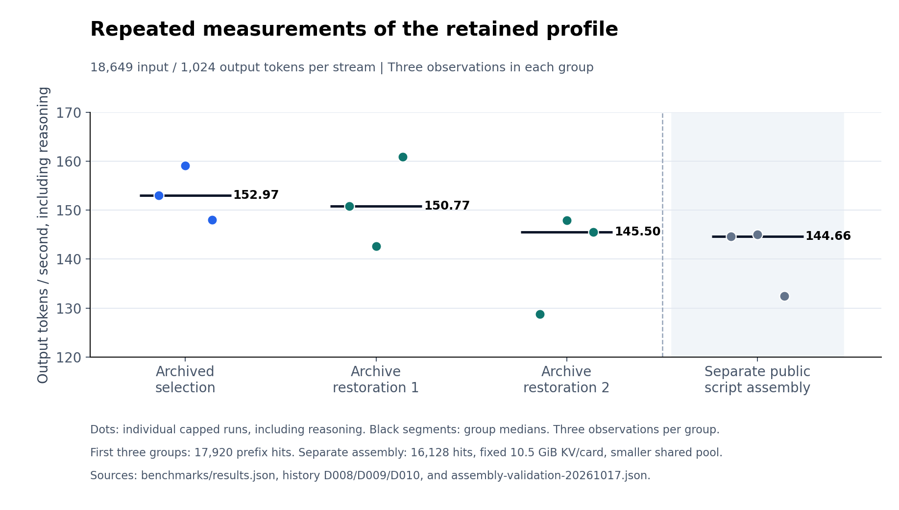

# How we selected the dual-3090 recipe

**English | [简体中文](exploration.zh-CN.md)**

The starting problem was practical: return to a long Claude Code conversation, send a message, and get useful work done on local GPUs. A loaded model and a large configured context window did not establish that the next turn would be fast. Images, tool results, speculative decoding, cache reloads and several simultaneous clients each exposed a different part of the serving path.

The retained recipe is vLLM 0.30 native DFlash2 with nine unchanged public HyperQwen patches. Its headline is **153 token/s median on one warm 18,649-token history**, with independent restoration medians of **151** and **146**. The public-script reconstruction reached **145** under a different KV budget. These numbers describe specific profiles and workloads. Long-context and multi-client validation continues from this retained baseline.

This report follows the decisions that led there. [The data archive](../benchmarks/history/README.md) contains 247 surviving source artifacts across eight campaigns, 236 distinct original SHA256 digests, and 41 curated CSV rows. Nested stages and summary reports overlap; these are artifact counts, not 247 independent experiments.

## 1. Match every result to its configuration

The [result lineage](../benchmarks/history/lineage.json) maps each result family to its runtime, precision and role. A shared model or engine name is insufficient to transfer a result to the selected profile.

| Result family | Actual setup | Role in the decision | Selected recipe result? |
| --- | --- | --- | --- |
| Early llama.cpp | GGUF Q4_K_M; optional Q4_0 MTP draft; incomplete launch recovery | Allocation and tiny-input diagnostics | No |
| SGLang TP/PP | 0.5.19 cu129, AWQ W4A16, MTP; PP2 FP8 KV and compatibility adaptations, partial TP2 launch recovery | Same-prompt observations and client integration | No |
| SGLang native dynamic chunking | PP2, native calibration enabled | Startup/calibration failure | No measured inference rate |
| vLLM W4A8 long history | 0.23 cu129, PP2, no speculation | Completed 520k history, chunk sizes and prefill decay | No |
| Earlier vLLM MTP/DFlash | 0.23/0.28 and experimental 0.30 branches | Speculation, precision, CUDA graph and actual-client exploration | No |
| Local shared-verification kernels | Experimental native 0.30 KVarN branch | Matched controls; subsequently retired | No |
| Official packed/MQ3D/W4A8 candidates | Native 0.30, differing complete profiles | Profile selection | No |
| **Retained TP2 profile** | **Native 0.30 + nine public patches, batch 7167, block 1792** | **Repeated 18.6k warm measurements and archive restoration** | **Yes** |
| Public-script reconstruction | Same public algorithms; fixed 10.5 GiB KV/card | Rebuild validation and thermal boundary | Separate assembly result |

The target body remains 4-bit in the AWQ trials. **W4A8 means 4-bit weights and 8-bit activations.** The selected target uses an AWQ4 body with INT8 embeddings/output head, a W4A16 DFlash2 draft, INT4 target KV and BF16 draft KV. Earlier KV formats, draft formats and runtime overlays differ.

## 2. First make the model fit and the client work

Six surviving llama.cpp logs cover the early Q4_K_M/near-1M configuration. Four ended with model-loading/allocation failures. A no-MTP trial recorded **41.51 token/s on 21 prompt tokens and 128 outputs**. An MTP trial recorded **17.23 token/s** on the same token counts, with reported draft acceptance 0.921 and mean emitted length 2.82.

The exact launch/build metadata is incomplete. These are tiny-input server timings, and the MTP log name does not prove where every draft operation executed. They establish what happened in those trials; they do not provide a matched llama.cpp-versus-vLLM speedup. See [L001–L006](../benchmarks/history/campaigns/L.json).

Client integration was a separate acceptance condition. The surviving records cover multimodal loading, Anthropic content handling, tool round trips and actual Claude Code turns. A high generation counter was insufficient when the client could not complete its request. The selected profile's Read-tool and two-round checks are recorded separately from capped generation measurements in [results.json](../benchmarks/results.json).

## 3. A promising prefill window led to a long-context measurement

The October 10 vLLM 0.23 W4A8 campaign tried TP2, PP2 and different static chunk budgets on the real paper history.

| Configuration | Batch-token budget | Completed tokens in sampling window | Window duration | Window prefill rate | First completed chunk |
| --- | ---: | ---: | ---: | ---: | ---: |
| TP2 | 8,192 | 15,680 | 10.071 s | 1,557 token/s | 14.87 s |
| PP2 | 4,096 | 34,496 | 10.036 s | **3,437 token/s** | 11.81 s |
| PP2, larger chunk | 6,272 | 31,360 | 10.042 s | 3,123 token/s | 12.92 s |

These windows start after the first completed chunk. They are not end-to-end time to first token, and they are not the speed of processing all 520k tokens. The early PP result justified continuing that configuration at the time. It did not establish that PP would win decode or every later configuration.

The completed **520,761-token** run exposed the next problem:

The first batch is excluded from this median analysis. This statistic differs from the earlier 3,437 token/s window. End-to-end cold prefill averaged **654 token/s** and client-visible first token took **797.10 s**. Sources: `S038` and `S036` in [campaign S](../benchmarks/history/campaigns/S.json).

The next two turns also show why cache hits and decode need separate acceptance:

| Turn | Actual input | Engine cached tokens | Prefix hit rate | Client first token | Decode |
| --- | ---: | ---: | ---: | ---: | ---: |
| Cold | 520,761 | 0 | 0% | 797.10 s | 21.48 token/s |
| Follow-up 1 | 523,234 | 522,144 | 99.79% | 12.91 s | 18.38 token/s |
| Follow-up 2 | 525,005 | 523,712 | 99.75% | 14.07 s | 18.79 token/s |

These are **vLLM W4A8 PP2 without speculation**, not SGLang or the final DFlash2 profile. Engine hits were observed, while that Anthropic adapter still reported zero cache tokens. This established same-engine prefix reuse for that old configuration; restart persistence and multi-day retention were not verified.

## 4. Test PP, TP and dynamic chunking separately

SGLang's native dynamic chunking was enabled in a dedicated PP2 trial. Its calibration produced a negative fitted quadratic coefficient after 128 samples and failed **before the real request**. There is no measured dynamic-chunking prefill or decode rate to report (`S013`).

Another PP launch summary inherited a `native_dynamic_chunking=true` field even though its actual arguments omitted the enabling flag. Its performance report says false. [Recovered flags](../benchmarks/history/configurations.json) preserve that discrepancy; the curated record labels this static PP. The static long-history gate processed 16,384 tokens in approximately 10.025 s of the observation window, about 1,634 token/s, and was canceled without measuring decode.

The later SGLang MTP layout control used the same first paper prompt, **5,224 input / 4,096 output tokens**:

| SGLang layout | First thinking/text delta | Whole question completed? |
| --- | ---: | --- |
| TP2 | 4.42 s | Yes, after continuation |
| PP2 | 5.51 s | Yes, after continuation |

Dynamic chunking was disabled in this decode test. The historical PP branch included upstream backports and compatibility adaptations; its recovered launch specifies FP8 E5M2 KV and a 65,536 context limit. Complete TP2 launch recovery is unavailable. Each layout has one first-phase observation, and later continuation contexts diverge. This is a same-prompt observation, with other configuration effects unresolved. Source `S016` retains both API phases and their metric definition.

**Chunked prefill, static chunk-size tuning and native dynamic chunk calibration are three distinct records in this exploration.** Enabling a flag is not evidence of a faster real workload.

## 5. Speculation required precision, graph and correctness checks

Earlier vLLM 0.23 short Claude Code questions covered MTP proposal lengths, greedy/probabilistic drafting, attention backends, graph modes, recurrent-state precision and DFlash2/8.

| Historical candidate | Actual first-API input | First-API decode | Outcome |
| --- | ---: | ---: | --- |
| MTP1, FlashInfer, FP8 KV, greedy draft | 5,199 | 24.49 token/s | Turn incomplete; requested full-decode graph mode fell back |
| MTP3, Triton INT8 KV, greedy draft | 5,199 | 42.66 token/s | Turn completed |
| MTP3, Triton INT8 KV, probabilistic draft | 5,203 | 59.47 token/s | Turn completed |
| MTP5, Triton INT8 KV, greedy draft | 5,199 | 42.71 token/s | Turn completed after additional continuation |
| Earlier DFlash2 + INT8-head preparation | 5,204 | 80.57 token/s | Turn completed |
| DFlash2 with FP16 recurrent state, October 15 | 5,175 | 82.23 token/s | Turn completed |

The inputs, precision, draft integration and generated continuations differ, so this is an exploration matrix. A matched speedup is not computed from its rows. DFlash8 and some W4A8 candidates produced no completed API phase and are retained as incomplete attempts. Full records are in [summary.json](../benchmarks/history/summary.json) and campaigns [S](../benchmarks/history/campaigns/S.json)/[P](../benchmarks/history/campaigns/P.json).

The native 0.28/0.30 client campaigns subsequently crossed 100 token/s on short paper questions, and exercised longer actual-client turns. Their contexts changed between rounds. A recorded **89.97 token/s** turn reached **37,208 context tokens**; it was not a 120k-token decode result.

### The historical custom-kernel branch

One earlier native 0.30 branch also tried locally authored shared-verification kernels. The same 18,649-token request produced these medians:

| Historical configuration | Runs | Median decode | Median step time |
| --- | ---: | ---: | ---: |
| Original lookup-enabled profile | 3 | 123.14 token/s | 24.83 ms |
| Lookup disabled | 3 | 135.13 token/s | 24.89 ms |
| Lookup disabled, forced NCCL LL | 3 | 134.11 token/s | 25.01 ms |
| First shared-verification candidate | 3 | 147.87 token/s | 23.51 ms |
| Six-run shared confirmation | 6 | 140.84 token/s | 24.56 ms |
| Shared verification, eight warps | 4 | 141.70 token/s | 23.75 ms |

The first three eight-warp outputs matched their lookup-disabled references exactly, with about 4.7–4.9% paired rate increases; a greedy 512-token check also matched. A different shared candidate had output differences, and a peak of 164 token/s did not establish a better accepted profile. These controls are in `D001`.

**This locally authored kernel is retired. It is absent from the selected public recipe.** Its complete Claude turns at 153.56/150.03 token/s and its 120k decode at 75.34 belong to that historical branch. They must not be credited to the final public-patch profile.

## 6. Select a public profile, then verify that it can be restored

The next campaign returned to the complete official vLLM 0.30 wheel and public HyperQwen patch sequence. Its measured whole-profile candidates included official packed INT4, an MQ3D subset, W4A8 activations and the retained W4A16 profile.

| Native 0.30 whole-profile trial | Cache / output conditions | Measured decode | Interpretation |
| --- | --- | ---: | --- |
| Official packed INT4, cold | 18,649 input, 1,024 output, profiling enabled | 32.73 token/s | Baseline complete profile |
| Official packed INT4, warm | 16,128 cache hits, 1,024 output, profiling enabled | 24.10 token/s | Baseline warm observation |
| Public MQ3D subset, warm | Same source history, 1,024 outputs, profiling enabled | 58.84 / 92.21 token/s | Two candidate observations |
| W4A8-activation candidate, warm | Same source history, 16,128 hits, 1,024 outputs | 139.24 / 133.91 / 123.32 | Rejected as the default |
| Earlier public W4A16, batch 3583 | Same source history, three warm 1,024 outputs | Median 149.18 | Earlier retained candidate |
| **Public W4A16, batch 7167** | **17,920 hits, three 1,024 outputs** | **Median 152.97** | **Archived selection** |

These are different complete profiles, including draft/precision, patch set, cache and profiling conditions. The table records whole-profile selection; component effects have their own controls.

The archived selection used seven native DFlash2 speculative tokens, standard rejection, lookup disabled, FP16 recurrent state, GPU prefix caching and upstream LMCache. There are nine unchanged public patches and zero locally authored inference kernels in this profile. The [patch/runtime audit](../benchmarks/runtime-audit.json), [checkpoint audit](../benchmarks/preparation-audit.json), pinned launch and public preparation scripts record its identity.

| Selected-profile evidence | Median warm decode | What was checked |
| --- | ---: | --- |
| Original archive | **152.97 token/s** | 18,649 input; 17,920 hits; 1,024 output each |
| Independent restoration | **150.77 token/s** | Archive restored and request replayed |
| Later restoration | **145.50 token/s** | Second independent recovery session |
| Public-script assembly | **144.66 token/s** | Separate rebuilt runtime/checkpoint, reused dependencies; 10.5 GiB KV/card |

The assembly is a separate configuration with 16,128 hits and a smaller shared KV pool. It is not an additional identical-profile replicate. The capped runs include reasoning and stop before answer text. Complete actual-client checks and first-answer latency remain separate in [measurement notes](measurements.md).

The figure shows all twelve observations. Individual values remain in the linked JSON, with three observations per group.

One actual unload/restart recovered **16,128 text-prefix tokens from external cache**, with zero GPU prefix hits, first thinking/text at **2.15 s**, and decode at **161.83 token/s**. This is a separately recorded restart observation. See [cache behavior](cache.md).

## 7. Validate several real clients

The historical five-client Claude Code campaign observed all five generating. Four completed two rounds, while one reached the experiment deadline. Four ten-second all-five windows totaled **234.9–258.4 token/s**. These are aggregate generation windows.

The selected public TP2 profile's separate five-request replay observed five running, with **56.47–69.04 token/s per stream**. Four requests emitted 1,024 tokens and one stopped for a tool after 311. The [archived conditions](../benchmarks/history/summary.json) identify the shared history, output lengths and running-request observations.

Historical sub-block alignment, larger prefill buffers and five API-server processes also explored long-history admission. Their exact request conditions and timings remain in the experiment data. These branches retain their own configuration identities.

## 8. What this exploration supports

The useful result is a pinned, restored local profile and the evidence explaining its selection. The data distinguish fit from speed, early prefill from late prefill, draft acceptance from end-to-end decode, configured slots from running clients, and cache hits from usable next-turn latency.

For this host, the retained public TP2 profile is the recommended **18.6k warm interactive configuration**. The configured 1M limit and five slots use a shared pool of roughly 1.32M tokens. Additional long-context, multi-client and multi-day cache measurements are the next validation steps.

The algorithms belong to [vLLM](https://github.com/vllm-project/vllm), [HyperQwen](https://github.com/syv-ai/HyperQwen), [DFlash](https://github.com/z-lab/dflash) and [LMCache](https://github.com/LMCache/LMCache), with earlier experiments using [SGLang](https://github.com/sgl-project/sglang) and [llama.cpp](https://github.com/ggml-org/llama.cpp). This repository contributes the host-specific selection, reconstruction, integration and documented measurements. Private prompts are excluded, so the archive is not an exact public replay or a general model-quality benchmark.

**Next:** preserve the restored TP2 profile, gather reproductions on other dual-3090 hosts, and extend long-context and cache-reuse measurements. Reproductions with actual context, cache state, topology and each stream's rate are welcome through the [reporting guide](../CONTRIBUTING.md).
